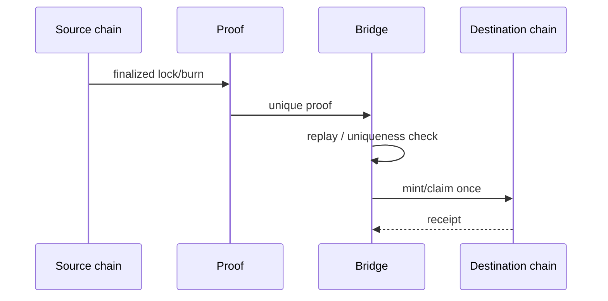

# 🌉 SYNERGY MetaChain

> **Cross-chain / bridge architecture with strict conservation and replay-safety rules.**

## 🎯 Роль

`synergy_metachain` — доменный владелец cross-chain/bridge-механизмов в федерации SYNERGY. Репозиторий пока документно-ориентированный, но уже содержит формальный legacy import queue.

## 🔒 Канонический bridge-инвариант

В `docs/LEGACY_DISTILLATION_V3_IMPORT_QUEUE.md` закреплён обязательный gate:

> каждый destination mint/claim должен соответствовать одному уникальному finalized source lock/burn proof; replay и double-mint обязаны завершаться отказом.

Кроме того, Financial OS не должен одновременно признавать и locked source asset, и mirrored claim как два независимых hard assets.

## 🧪 Required negative tests

- replay same proof;
- second mint from same source event;
- non-finalized source event;
- chain reorg invalidation;
- amount/asset/domain mismatch;
- forged destination receipt;
- duplicate HardNAV recognition;
- partial failure and recovery.

## 🔗 Связи

- [`synergy_ai_blockchain`](https://github.com/Shtenco/synergy_ai_blockchain) — trust/state layer;
- [`synergy_financial_os`](https://github.com/Shtenco/synergy_financial_os) — accounting authority;
- [`synergy_pay_system`](https://github.com/Shtenco/synergy_pay_system) — settlement routing;
- [`synergy_net`](https://github.com/Shtenco/synergy_net) — transport.

## 🚀 Roadmap

- [ ] formal bridge state machine;
- [ ] proof schema;
- [ ] idempotent claim ledger;
- [ ] replay cache;
- [ ] reorg/finality model;
- [ ] cross-chain accounting test fixtures;
- [ ] deterministic bridge simulator;
- [ ] adversarial test suite.

## 🧭 Федерация

[Атлас всех 75 репозиториев](https://github.com/Shtenco/synergy_system/blob/main/docs/SYNERGY_REPOSITORY_ATLAS.md)
