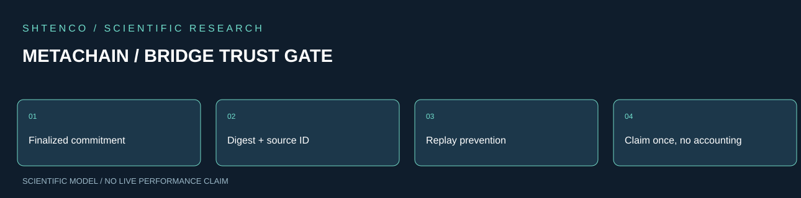
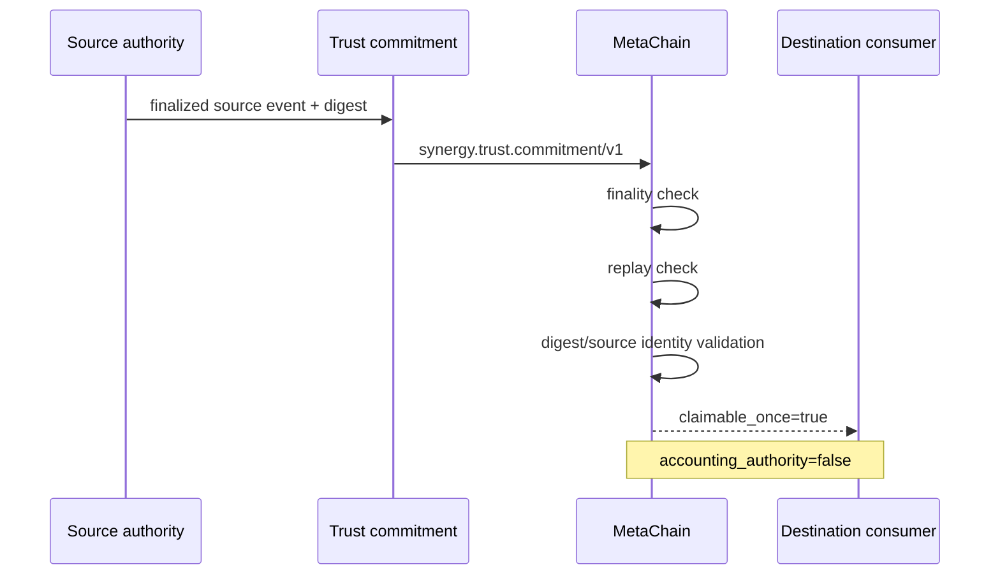
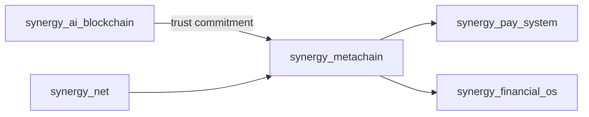

<!-- RESEARCH-V2-2026:START -->


[Полное научное досье V2](docs/SCIENTIFIC_DOSSIER_V2_2026.md) — исследовательский вклад, математика и воспроизводимость. Весь прежний README сохранён.
<!-- RESEARCH-V2-2026:END -->

#  SYNERGY MetaChain — verified technical dossier

> **Статус:**  CANDIDATE — trust-consumer/replay guard реализован; полноценный cross-chain bridge/state machine ещё не доказан.
> **Проверено по фактическому `main`:** 29.09.2026.

## 1.  Задача

`synergy_metachain` — граница cross-chain / bridge trust внутри федерации SYNERGY. Ключевая проблема любого bridge-механизма — не сам перенос сообщения, а сохранение уникальности экономического события:

```text
one finalized source event
→ one valid proof
→ at most one destination claim
```

и недопущение двойного признания одного экономического актива.

## 2.  Фактическое дерево

```text
synergy_metachain/
├── README.md
├── docs/
│   ├── LEGACY_DISTILLATION_V3_IMPORT_QUEUE.md
│   └── legacy_distillation_v2/
│       └── IMPORT_QUEUE.md
├── runtime/
│   └── trust_contracts.py
└── tests/
    └── test_trust_contracts.py
```

Это уже не чисто документный repo: есть исполняемый trust-consumer и тесты.

## 3.  Реализованный runtime

`runtime/trust_contracts.py` объявляет upstream contract:

```text
synergy.trust.commitment/v1
```

Основной объект — `CommitmentReplayState`.

### `consume(payload)`

Consumer принимает payload только если:

- `finality_status == FINALIZED`;
- есть `commitment_id`;
- этот `commitment_id` ещё не consumed;
- `payload_sha256` — валидный 64-hex digest;
- заданы `source_event_id` и `source_contract_id`.

После успешного consume commitment id добавляется в replay state, а результат содержит:

```text
source_event_id
source_contract_id
payload_sha256
commitment_id
claimable_once = true
accounting_authority = false
```

Последнее поле принципиально: даже валидированный trust commitment **не становится бухгалтерской authority**.

## 4.  Архитектура



Текущий runtime — **trust/replay gate**, а не полный token bridge.

## 5.  Inputs

Реализованный consumer ожидает:

```text
source_event_id
source_contract_id
payload_sha256
commitment_id
finality_status
```

Не реализованы в этом модуле:

- chain RPC;
- lock transaction generation;
- burn transaction generation;
- destination mint execution;
- validator set;
- light client;
- Merkle/SPV verification;
- reorg watcher.

## 6.  Outputs

После успешной проверки:

```text
{
  source_event_id,
  source_contract_id,
  payload_sha256,
  commitment_id,
  claimable_once: true,
  accounting_authority: false
}
```

Это доказательство прохождения конкретного local trust gate, а не доказательство того, что внешний chain действительно исполнил mint/burn.

## 7.  Канонические bridge-инварианты

```text
one source event -> at most one destination claim
PENDING source != claimable
replayed commitment -> reject
invalid digest -> reject
missing source identity -> reject
bridge proof != accounting truth
mirrored claim + locked asset != two independent HardNAV assets
```

Экономический закон:

[
	ext{HardNAV}_{consolidated}

eq
	ext{locked source asset}
+
	ext{mirror of same asset}
]

если mirror представляет ту же самую экономическую собственность.

## 8.  Реальные тесты

`tests/test_trust_contracts.py` содержит два ключевых сценария:

### Finalized commitment consumed once

- finalized payload принимается;
- возвращается `claimable_once=true`;
- `accounting_authority=false`;
- повторный consume того же commitment вызывает `ValueError`.

### Non-finalized commitment fails

Payload с `finality_status=PENDING` отвергается.

Это реальные unit tests исходников. README не превращает наличие тестов в утверждение о production bridge.

## 9.  Legacy distillation evidence

### V2 import queue

`docs/legacy_distillation_v2/IMPORT_QUEUE.md` перечисляет bridge-family механизмы:

| ID | Action | Occurrences | Gate |
|---|---|---:|---|
| M022 | REWRITE_REQUIRED | 140 | lock/burn/mint conservation |
| M023 | REWRITE_REQUIRED | 134 | lock/burn/mint conservation |
| M024 | PROMOTION_CANDIDATE | 36 | lock/burn/mint conservation |
| M025 | PROMOTION_CANDIDATE | 24 | lock/burn/mint conservation |
| M026 | PROMOTION_CANDIDATE | 20 | lock/burn/mint conservation |
| M027 | PROMOTION_CANDIDATE | 13 | lock/burn/mint conservation |
| M028 | PROMOTION_CANDIDATE | 4 | lock/burn/mint conservation |

То есть старый corpus содержит значительный bridge-code footprint, но он **не auto-promoted**.

### V3 import queue

`LEGACY_DISTILLATION_V3_IMPORT_QUEUE.md` дополнительно фиксирует:

- P009 — rewrite;
- P010 — promote with gate;
- destination claim обязан соответствовать unique finalized source lock/burn proof;
- replay/double-mint обязаны падать;
- Financial OS не должен считать source lock и mirror двумя отдельными hard assets.

## 10.  Threat / failure model

| Риск | Текущий/требуемый gate |
|---|---|
| replay одного commitment |  локально блокируется |
| claim по PENDING source |  блокируется |
| malformed digest |  блокируется |
| missing source identity |  блокируется |
| same source event under two commitment IDs |  ещё нужен source-event replay index |
| chain reorg after finality claim |  не реализовано |
| forged validator/light-client proof |  не реализовано |
| destination mint twice by external executor |  не доказано |
| accounting double-recognition | policy описана, E2E не доказан |
| partial lock/mint failure |  state machine отсутствует |

## 11.  Required negative tests следующего уровня

- два разных `commitment_id` для одного `source_event_id`;
- amount mismatch;
- asset/domain mismatch;
- source chain mismatch;
- forged finality;
- reorg invalidation;
- duplicate destination receipt;
- recovery after partial failure;
- concurrency race на replay state;
- persistent replay state after restart;
- multi-node replay consistency.

## 12.  Воспроизводимость

Ожидаемый локальный test path:

```bash
git clone https://github.com/Shtenco/synergy_metachain.git
cd synergy_metachain
python -m pip install pytest
pytest -q
```

Этот путь описывает локальное воспроизведение unit tests. До observed run он не маркируется как GREEN CI evidence.

## 13.  Карта репозитория

| Путь | Назначение | Статус |
|---|---|---|
| `runtime/trust_contracts.py` | trust commitment consumer + in-memory replay guard |  |
| `tests/test_trust_contracts.py` | unit tests finality/replay |  |
| `docs/legacy_distillation_v2/IMPORT_QUEUE.md` | legacy bridge queue |  |
| `docs/LEGACY_DISTILLATION_V3_IMPORT_QUEUE.md` | V3 promotion gates |  |
| persistent replay store | durable replay protection |  |
| chain adapter | source/destination RPC |  |
| bridge state machine | lock/burn/mint lifecycle |  |
| E2E harness | cross-chain observed execution |  |

## 14.  Место в SYNERGY



Смежные authorities:

- [`synergy_ai_blockchain`](https://github.com/Shtenco/synergy_ai_blockchain) — trust/state commitments;
- [`synergy_financial_os`](https://github.com/Shtenco/synergy_financial_os) — accounting truth;
- [`synergy_pay_system`](https://github.com/Shtenco/synergy_pay_system) — payment/settlement;
- [`synergy_net`](https://github.com/Shtenco/synergy_net) — transport.

## 15.  Evidence maturity

| Layer | Status |
|---|---|
| bridge invariants |  documented |
| replay consumer |  implemented |
| unit tests |  repository contains |
| persistent replay protection |  |
| exact chain finality verification |  |
| lock/burn/mint conservation E2E |  |
| multi-chain execution |  |
| accounting E2E |  |
| production bridge |  |

## 16.  Roadmap

1. bind replay uniqueness to both commitment id and source event id;
2. persistent replay storage;
3. typed asset/amount/domain fields;
4. source-chain finality adapter;
5. destination execution receipt;
6. explicit bridge state machine;
7. reorg handling;
8. conservation property tests;
9. crash/restart tests;
10. two-node / two-chain deterministic simulator;
11. Financial OS double-recognition negative test;
12. observed federation evidence.

## 17.  Что проект НЕ утверждает

- что полноценный bridge уже работает;
- что токены реально mint/burn across chains;
- что source-chain consensus проверяется этим repo;
- что replay state уже durable;
- что accounting автоматически следует trust commitment;
- что unit tests = E2E;
- что bridge production-ready.

---

[ SYNERGY SYSTEM](https://github.com/Shtenco/synergy_system) · [ Атлас 75 репозиториев](https://github.com/Shtenco/synergy_system/blob/main/docs/SYNERGY_REPOSITORY_ATLAS.md) · [ Registry](https://github.com/Shtenco/synergy_system/blob/main/registry/SYNERGY_REPOSITORIES.json)
