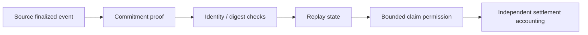

# MetaChain — single-claim trust primitive and bridge research

## Scientific contribution

Cross-chain economic trust is ultimately about **not recognizing the same event twice**. A source-chain event and its mirrored target-chain representation must not automatically be counted as two owned external assets.

The implemented [CommitmentReplayState](../runtime/trust_contracts.py) is a small but meaningful trust-consumer primitive. It requires FINALIZED status, nonempty commitment and source identities and a well-formed 64-hex SHA-256 field, and rejects a repeated commitment ID.

## Formal invariant

Let $C$ denote accepted commitment identifiers. The consumer operation is valid only if $id\notin C$, and after successful acceptance:

$$
C_{t+1}=C_t\cup\{id\}.
$$

Thus, within one live state instance, acceptance of a given ID occurs at most once. This is not yet a distributed proof: persistence across restarts, atomic storage commits, race safety, source-chain finality verification and canonical Merkle proof validation remain further research milestones.

The output deliberately sets `claimable_once=true` and `accounting_authority=false`. A claimed destination representation does not become external profit without Financial OS settlement and consolidation.

## Trust architecture

## Proposed experiment

Use deterministic event fixtures and adversarial sequences: stale/pending finality, copied ID under changed payload, double submission, concurrent calls, crash-and-restart replay and chain reorganization. Require exactly-once committed state via durable transactional store, not only process memory. Introduce chain-specific proof verification and conservation reconciliation before representing the module as a bridge.

## Potential value

A modular proof gateway can support multi-chain transfers, event-based asset portability and interoperability between separate settlement domains. The strongest idea is **verifiable trust transfer without duplication of economic authority**.

[Runtime](../runtime/trust_contracts.py) · [Tests](../tests/test_trust_contracts.py)
